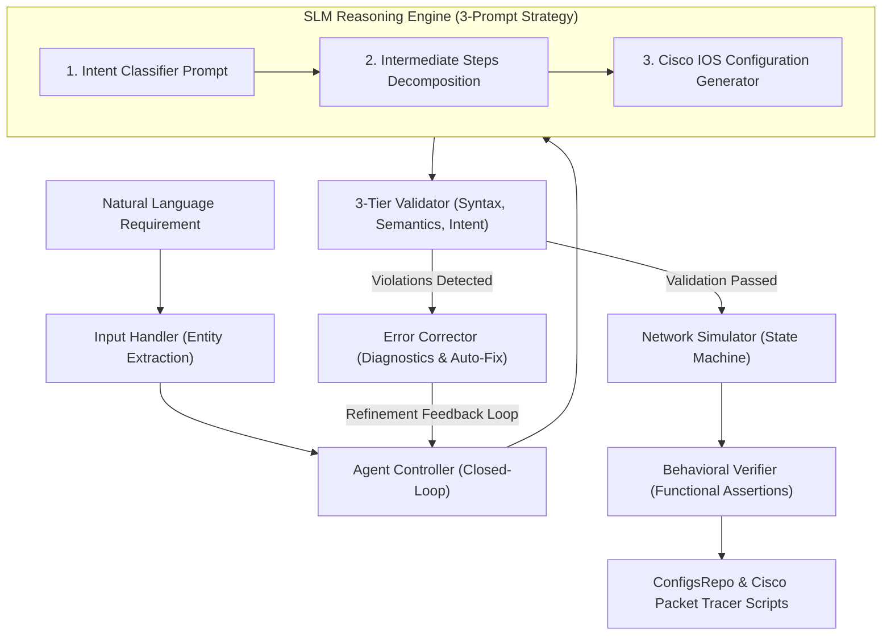

# SLM NetConfig

> **Autonomous Network Configuration via Small Language Models with Closed-Loop Verification**  
> Grounded in research from *"Network Self-Configuration Based on Fine-Tuned Small Language Models"*, IEEE Open Journal of the Communications Society (OJCOMS), Vol. 7, 2026.

---

## 1. Overview

Enterprise and datacenter network management demands precise, frequent, and syntax-critical device configuration. Manual Command-Line Interface (CLI) configuration is labor-intensive, vendor-dependent, and prone to human errors—a leading contributor to enterprise network downtime and security policy violations.

While general-purpose Large Language Models (LLMs) can generate code, deploying them directly for network administration introduces major challenges: high translation latencies (often minutes per topology), steep computational costs, hallucinations of non-existent CLI commands, and serious data privacy risks associated with transmitting proprietary network topologies over public cloud APIs.

**SLM NetConfig** provides an on-premise, privacy-preserving, and lightweight alternative. By integrating a fine-tuned Small Language Model (SLM) with an autonomous **Agentic Closed-Loop Verification Pipeline**, the system translates natural language administrative requirements into validated Cisco IOS XE configurations, catches syntax and semantic violations before deployment, and simulates device states in sub-second runtimes.

---

## 2. Key Features

- **Natural Language Entity Extraction:** Automatically extracts intent types, VLAN IDs, interface names, IPv4 addresses, subnet masks, OSPF areas, and Access Control List (ACL) parameters from plain English (`app/input_handler.py`).
- **3-Prompt SLM Reasoning Architecture:**
  - *Requirement Classifier Prompt:* Accurately identifies intent category (VLAN, VLAN Trunking, IP Addressing, Static Routing, OSPF Routing, DHCP, or Security ACL).
  - *Intermediate Steps Decomposition:* Breaks complex, multiplex administrative requirements into ordered configuration subtasks prior to CLI generation.
  - *Configuration Generator:* Formats deterministic, vendor-specific Cisco IOS XE command blocks without conversational filler.
- **Dual Execution Modes:**
  - *Transformer / LoRA Mode:* Supports local or cloud execution of `Qwen/Qwen2.5-Coder-1.5B-Instruct` or `meta-llama/Llama-3.2-1B` with Parameter-Efficient Fine-Tuning (PEFT) adapters (`training/lora_train.py`).
  - *Domain-Grounded Fallback Engine:* Provides an offline, rule-grounded reasoning engine enabling sub-second response times without requiring GPU hardware or large model downloads.
- **3-Tier Automated Validation:**
  - *Tier 1 (Syntax):* Validates commands against Cisco IOS XE grammar, command tree hierarchies, and keyword specifications.
  - *Tier 2 (Semantics):* Enforces network domain boundaries (e.g., catching reserved VLANs `1`, `1002`–`1005`, valid CIDR ranges, and interface types).
  - *Tier 3 (Intent):* Verifies that the generated configuration completely satisfies all constraints of the input requirement.
- **Error Detection & Auto-Correction:** Catches common CLI typos (e.g., `acces` $\rightarrow$ `access`), flags erroneous line numbers, and attempts safe, deterministic correction before re-prompting.
- **Discrete Network State Simulator:** Maintains in-memory device state machines (VLAN database, interface status table, IP routing table, and ACL packet filters) to verify functional correctness (`simulation/network_simulator.py`).
- **Cisco Packet Tracer Automation:** Automatically exports ready-to-paste scripts (`.ios` and `.txt`) with execution instructions for Cisco Packet Tracer and GNS3 (`output/PacketTracer_Exports/`).
- **Multiple Operational Interfaces:** Provides a modern single-page web dashboard, an interactive Streamlit research app, and a scriptable CLI.

---

## 3. System Architecture

The following diagram illustrates the closed-loop perception-reasoning-action-verification cycle implemented by the orchestrating Agent:



---

## 4. Technology Stack

| Category | Technologies / Libraries |
| :--- | :--- |
| **Core Language** | Python 3.10+ |
| **Machine Learning & Fine-Tuning** | PyTorch, Hugging Face `transformers`, `peft` (LoRA), `accelerate`, `datasets` |
| **Network Configuration Parsing** | `ciscoconfparse2` |
| **Web & Dashboard Interfaces** | Python `http.server` REST API (`app/server.py`), HTML5, CSS3, JavaScript, `streamlit` |
| **Data & Metrics Analysis** | `pandas`, `numpy`, `matplotlib`, `seaborn`, `rich` |
| **Automated Testing** | `pytest` (16 automated unit & integration test cases) |
| **Network Emulation Targets** | Cisco Packet Tracer, GNS3 |

---

## 5. Project Structure

```
SLM_NetConfig/
├── app/
│   ├── input_handler.py        # Natural language parsing & entity extraction
│   ├── server.py               # Lightweight HTTP REST server backend
│   ├── static/                 # Production web dashboard (HTML, CSS, JS)
│   └── ui.py                   # Multi-tab Streamlit evaluation dashboard
├── controller/
│   └── agent.py                # 4-component orchestrator with closed-loop cycle
├── knowledge_base/
│   ├── cisco_ios_commands.json # Cisco command specifications & parameters
│   ├── networking_rules.json   # Subnet rules, reserved VLANs, and typo map
│   ├── config_patterns.json    # Standard configuration AST patterns
│   └── kb_manager.py           # Grounding retrieval engine
├── dataset/
│   ├── build_dataset.py        # 7-stage dataset engineering pipeline
│   ├── dataset_loader.py       # Dataset access loader for train/val/test splits
│   ├── train/                  # Declarative & interrogative training datasets
│   ├── validation/             # Validation dataset
│   └── test/                   # 150-scenario benchmark evaluation dataset
├── models/
│   └── slm_engine.py           # 3-prompt SLM engine (Transformer & Fallback)
├── training/
│   ├── lora_train.py           # PEFT / LoRA fine-tuning script
│   └── SLM_NetConfig_Colab_FineTuning.ipynb # Google Colab T4 training notebook
├── generation/
│   └── config_generator.py     # Multi-device Cisco CLI formatter
├── validation/
│   └── validator.py            # 3-tier validation (Syntax, Semantics, Intent)
├── correction/
│   └── error_corrector.py      # Diagnostic explanations & typo auto-fix
├── simulation/
│   ├── network_simulator.py    # Discrete Cisco IOS state machine simulator
│   └── packet_tracer_exporter.py # Automation script exporter for Packet Tracer
├── verification/
│   └── verifier.py             # Behavioral assertions against simulated state
├── evaluation/
│   └── evaluator.py            # IEEE OJCOMS 2026 mathematical evaluation engine
├── tests/
│   ├── test_pipeline.py        # Automated test suite for core pipeline
│   ├── test_web_ui.py          # Integration test suite for web UI & server
│   └── generate_test_report.py # Automated test report generator
├── output/
│   ├── ConfigsRepo/            # Verified, approved device configurations
│   ├── PacketTracer_Exports/   # Ready-to-paste Cisco Packet Tracer scripts
│   └── benchmark_evaluation_report.json # Benchmark test results
├── netlify.toml                # Netlify deployment configuration
├── requirements.txt            # Project dependencies
├── run.py                      # Master CLI and application launcher
└── README.md
```

---

## 6. Prerequisites

- **Python:** Version 3.10 or higher.
- **Git:** Version 2.30 or higher.
- **Operating System:** Windows, macOS, or Linux.
- **Hardware (Optional for Model Training):** A CUDA-compatible GPU with 8 GB+ VRAM (or Google Colab Free Tier T4 GPU) is recommended if training or fine-tuning transformer weights via LoRA. The standard configuration and verification pipeline runs entirely on standard CPUs.

---

## 7. Installation and Setup

### 1. Clone the Repository
```bash
git clone https://github.com/riishaal/SLM_NetConfig.git
cd SLM_NetConfig
```

### 2. Set Up a Virtual Environment
**On Windows (PowerShell):**
```powershell
python -m venv .venv
.venv\Scripts\Activate.ps1
```

**On Linux / macOS (bash/zsh):**
```bash
python3 -m venv .venv
source .venv/bin/activate
```

### 3. Install Dependencies
```bash
pip install --upgrade pip
pip install -r requirements.txt
```

### 4. Verify Installation
Run the automated test suite to confirm all 16 test cases pass:
```bash
pytest tests/ -v
```
*Expected result:* `16 passed in < 1.5s`.

---

## 8. Configuration

- **Execution Engine Toggle (`load_model_weights`):**
  - `load_model_weights=False` (Default): Uses the built-in domain-grounded SLM reasoning engine. Operates with sub-second latencies and zero model weight downloads.
  - `load_model_weights=True`: Initializes Hugging Face transformer weights (e.g., `Qwen/Qwen2.5-Coder-1.5B-Instruct`) and attaches PEFT LoRA adapters from `training/checkpoints/` if present.
- **Web Server Port:** Configurable via the `--port` argument when launching the web interface (defaults to `5000`).
- **Zero Credentials Policy:** The application runs completely on-premise without requiring third-party API keys, tokens, or external cloud services.

---

## 9. Usage

### Option A: Web Interface (Recommended)
Launch the lightweight web application:
```bash
python run.py --ui --port 5000
```
Open your browser to `http://127.0.0.1:5000`. The interface provides:
- Natural language requirement input and target device selector.
- Preset scenario shortcuts (VLAN declaration, IP addressing, Trunking, OSPF).
- Live verification status badges (`APPROVED (PASSED)`, `REFINEMENT NEEDED`, or `ERROR`).
- Formatted Cisco IOS XE configuration with one-click copy.
- Output location paths and visual architecture flow diagram.

### Option B: Streamlit Dashboard
Launch the multi-tab Streamlit dashboard:
```bash
python run.py --streamlit
```
*Accessible at `http://localhost:8501`.*

### Option C: Command-Line Interface (CLI)
Execute an immediate query directly in the terminal:
```bash
python run.py --cli --query "Create VLAN 20 named Accounts and assign GigabitEthernet0/1 to VLAN 20."
```

### Option D: Cisco Packet Tracer Integration
1. Generate a configuration using either the Web UI or CLI.
2. Locate the generated automation script in `output/PacketTracer_Exports/` (e.g., `Switch1_VLAN_Switch1_pt_script.txt`).
3. Open **Cisco Packet Tracer**, place a **Catalyst 2960 Switch** (or 2911 Router), and navigate to the **CLI** tab.
4. Paste the script contents into the console.
5. Execute verification commands such as `show vlan brief` or `show ip interface brief` to verify the state on the device.

---

## 10. Evaluation and Testing

### Automated Test Suite
The project includes automated unit and integration tests covering input handling, agent closed-loop cycles, validation rules, typo auto-correction, and web API endpoints:
```bash
pytest tests/ -v
```

### 150-Scenario Benchmark Evaluation
The framework includes an evaluation engine implementing the mathematical metrics specified in Section VII-B of the IEEE OJCOMS 2026 paper:
```bash
python run.py --eval --samples 20
```
Key metrics computed against `dataset/test/test_benchmark_150.jsonl`:
- **Syntax Accuracy (Eq. 2 & 3):** Strict conformance to Cisco IOS grammar rules.
- **Goal Accuracy (Eq. 4):** Degree of fulfillment of input administrative requirements.
- **Translation Latency (Eq. 5 & 6):** Duration required for classification, steps decomposition, and synthesis.
- **Complexity Score (Eq. 7, 8 & 9):** Normalized metric combining requirement length, generated command length, and translation time.

---

## 11. Limitations

- **Vendor Scope:** Currently optimized for Cisco IOS XE syntax. Support for alternative network operating systems (e.g., Juniper Junos OS, Arista EOS) is not yet implemented.
- **Hardware Requirements for Full Transformer Weights:** Running the full 1.5B/1B parameter transformer locally requires substantial GPU VRAM (~4–8 GB). On standard development environments without GPUs, the built-in domain-grounded engine is utilized.
- **Simulator Fidelity:** The discrete network simulator models control-plane states (VLAN tables, IP routes, ACL filter chains) but does not emulate hardware packet switching rates, ASIC pipelines, or complex dynamic protocols such as BGP, MPLS, or VXLAN.

---

## 12. Future Improvements

- [ ] Add multi-vendor translation support for Juniper Junos OS and Arista EOS.
- [ ] Implement direct device synchronization via Netmiko, RESTCONF, and NETCONF.
- [ ] Incorporate 4-bit AWQ and GGUF quantization for edge deployment on low-power network management appliances.
- [ ] Expand the benchmark test dataset to cover complex enterprise topologies and dynamic routing protocols (BGP, EIGRP).

---

## 13. Project Team

**Department of Computer Science & Engineering, MEA Engineering College**

- **Muhammed Rishal K**
- **Muhammed Shahil K**
- **Rifa**
- **Riza Parveen T**

**Project Guide:**  
- **Prof. Nusna Khalid CK** (Assistant Professor, Department of CSE)

---

## 14. License

This project is developed for academic evaluation and research purposes. Licensing terms can be designated upon formal release.

---

## 15. References & Acknowledgments

1. **Primary Reference Paper:**  
   *"Network Self-Configuration Based on Fine-Tuned Small Language Models"*, IEEE Open Journal of the Communications Society (OJCOMS), Vol. 7, 2026.
2. **Cisco Documentation:**  
   Cisco IOS XE 17.x Command Reference and Configuration Guides.
3. **Open-Source Libraries:**  
   Hugging Face `transformers`, `peft`, `ciscoconfparse2`, and `pytest`.
